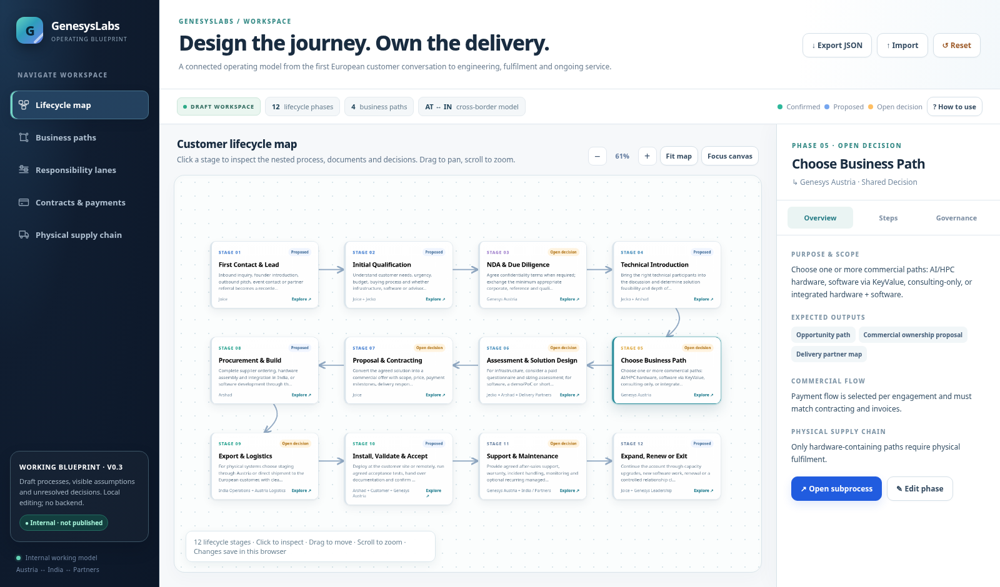

# GenesysLabs.ai Business Operating Blueprint

V0.3 is an internal, offline-first HTML/CSS/JavaScript application for reviewing the GenesysLabs.ai customer-to-operations business model. Business-process accuracy and usability are the primary objectives; Git, Docker, CI/CD and hosting are supporting learning objectives.

## Run locally

From this repository:

```powershell
python -m http.server 8000 --bind 127.0.0.1
```

Open <http://127.0.0.1:8000>. No npm installation, framework, backend or Docker is required. You can also open `index.html` directly in a desktop browser; browser storage behavior for local files can vary.

## Existing V0.3 features

- Twelve clickable lifecycle stages, stage inspector and editable subprocesses.
- Five views: lifecycle map, four business paths, responsibility lanes, contracts/payments and physical supply chain.
- Infrastructure, software/KeyValue, consulting-only and combined routes; both Austria staging and direct hardware shipment routes.
- Stage editing, browser-local persistence, JSON export/import, zoom/pan and focus mode.

This is a working planning model, not an approved SOP. Commercial, legal, payment and partner questions must retain their documented provisional status.

## Save and exchange edits

Edits live in this browser profile's `localStorage`; they do not update application source, Git or a partner's browser. Export JSON to back up or exchange a reviewed model. Changing browser profile, protocol, host or port can select a different storage area. Export valuable edits from the previous location before switching to this copy.

The baseline retains the existing `genesyslabs-operating-blueprint-v02` storage key and `genesyslabs-blueprint` JSON schema with export version `0.3`. Historical V0.2 export compatibility requires a representative export to verify; the integration does not change the importer or data structure.

## Source and context

| Path | Purpose |
| --- | --- |
| `index.html` | App entry point |
| `assets/styles.css` | Existing V0.3 styling |
| `src/blueprint-data.js` | Default stages and route data |
| `src/app.js` | Views, editing, navigation, storage and JSON exchange |
| `docs/OPERATING_MODEL.md` | Project business specification |
| `docs/memory/DECISIONS.md` | Project decisions |
| `docs/PROJECT_STATE.md` | Verified local state and next priorities |
| `docs/BASELINE_VERIFICATION.md` | Integration verification and known limitations |
| `docs/FOLLOW_UP_TASKS.md` | Improvements deferred from baseline integration |
| `docs/DEPLOYMENT.md` | Local workflow and optional infrastructure learning |



The official application repository is `E:\Experiments\GenesysLabs\Bus-Model`. The original `..\Bus-Oper-Model` remains a reference copy. Company-wide knowledge lives in the independent sibling repository `..\Shared-Context`; consult it through `AGENTS.md` without copying it into this application repository.

## Optional Docker exercise

The prototype's Docker files are retained without changes. They have not been validated during baseline integration. Do not start them as part of the baseline review; the local Python server is sufficient. See `docs/DEPLOYMENT.md` for the later learning track.

## Review and publication

Integration work remains local until reviewed. Do not commit, merge, push or deploy without explicit authorization. Verify the GitHub remote's current private visibility immediately before a future authorized push. This static app has no authentication or shared backend; public hosting is outside the current scope.
